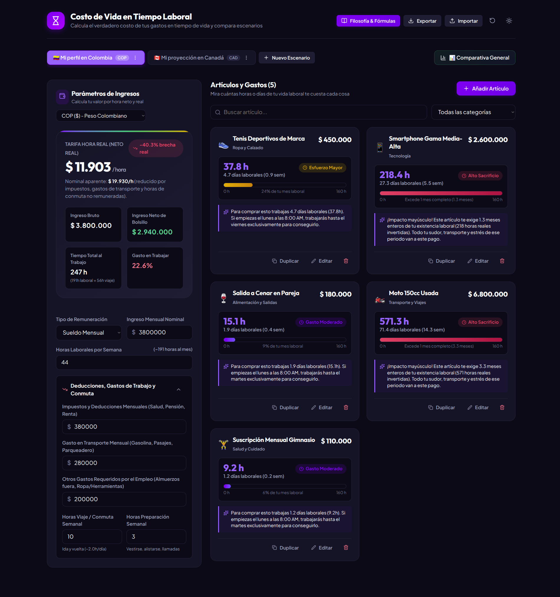
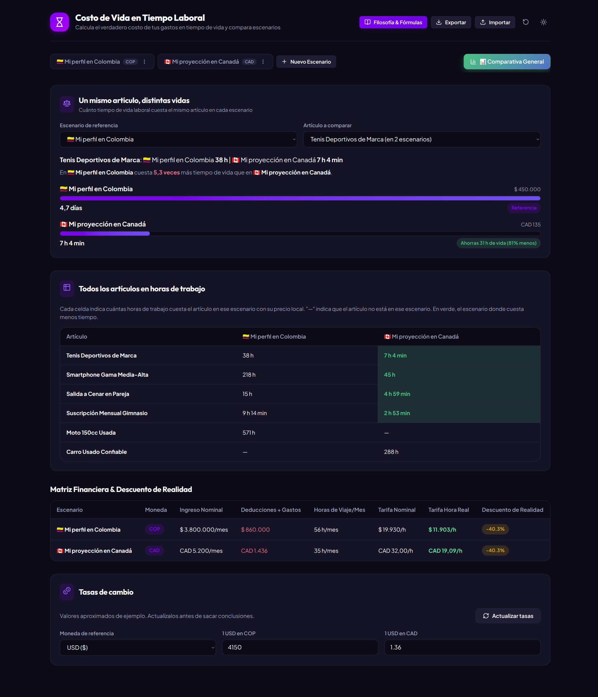

# Costo de Vida en Tiempo Laboral

Calcula cuánto te cuesta realmente cada compra, no en dinero, sino en **horas de vida que entregas al trabajo**, y compara ese costo entre distintos escenarios de vida (países, ciudades u ofertas de empleo).

> "No pagamos las cosas con dinero, las pagamos con el tiempo de vida que entregamos para ganar ese dinero."
> — José "Pepe" Mujica

---

## Escenarios



## Comparativa entre escenarios



---

## La idea

El precio de una etiqueta engaña: un teléfono no "cuesta" 2.600.000 pesos, cuesta la parte de tu vida que tuviste que entregar para ganarlos. La aplicación se inspira en _Your Money or Your Life_ (Vicki Robin y Joe Dominguez) y en las reflexiones de José Mujica, y desarma la ilusión del sueldo nominal con tres conceptos:

- **Tarifa hora nominal**: lo que parece que ganas por hora (ingreso bruto dividido entre las horas pagadas).
- **Tarifa hora real**: lo que de verdad te queda por cada hora de vida que dedicas al trabajo. Al ingreso se le restan impuestos, transporte y otros gastos que solo existen porque trabajas, y a las horas pagadas se les suman las que no te pagan: traslados y preparación.
- **Descuento de realidad**: el porcentaje en que la tarifa real queda por debajo de la nominal.

Con la tarifa real, cada artículo se traduce en horas, días laborales y fracción de un mes de trabajo.

## Funcionalidades

### Escenarios

- Cada escenario es un perfil financiero con su propia moneda. Hay 8 disponibles: USD, COP, CAD, EUR, MXN, CLP, ARS y GBP.
- El ingreso se define como **sueldo mensual** o **tarifa por hora**, junto con las horas laborales por semana.
- Deducciones y gastos mensuales: impuestos y deducciones (salud, pensión, renta), transporte, y otros gastos del empleo (almuerzos fuera, ropa, herramientas).
- Horas semanales no pagadas: traslados (ida y vuelta) y preparación.
- Métricas en vivo: tarifa hora real, tarifa nominal, brecha real (%), ingreso bruto, ingreso neto de bolsillo, tiempo total dedicado al trabajo (horas laborales más horas de viaje) y porcentaje del ingreso que se va en trabajar.
- Los escenarios se pueden crear (en blanco o copiando la configuración y los artículos de otro), renombrar, duplicar y eliminar. Siempre queda al menos uno.
- La primera vez se cargan dos escenarios de ejemplo: _Mi perfil en Colombia_ (COP, sueldo mensual) y _Mi proyección en Canadá_ (CAD, tarifa por hora).

### Artículos y gastos

- Cada artículo tiene nombre, precio, categoría y emoji. Las categorías son: Tecnología, Ropa y Calzado, Alimentación y Salidas, Transporte y Viajes, Vivienda y Hogar, Suscripciones y Ocio, Salud y Cuidado, y Otros.
- La tarjeta de cada artículo muestra:
  - las horas (o minutos) de vida que cuesta, los días laborales y las semanas;
  - una etiqueta de intensidad: _Fácil Adquisición_, _Gasto Moderado_, _Esfuerzo Mayor_ o _Alto Sacrificio_;
  - una barra con el porcentaje de un mes laboral de referencia de 160 h, que avisa cuando el artículo lo supera;
  - un texto que describe el esfuerzo en términos cotidianos (por ejemplo, "si empiezas el lunes a las 8:00 AM, trabajarás hasta el viernes…").
- Los artículos se pueden buscar por nombre, filtrar por categoría, añadir, editar, duplicar y eliminar.
- El formulario del artículo muestra el costo en tiempo mientras escribes el precio.

### Comparativa General

- **Un mismo artículo, distintas vidas**: eliges un escenario de referencia y un artículo, y ves cuánto tiempo de vida cuesta en cada escenario. Indica cuántas veces más caro es en el escenario más costoso y cuántas horas ahorras o pierdes frente a la referencia.
  - Los artículos con el mismo nombre en varios escenarios se agrupan y se comparan con el precio local de cada uno.
  - También puedes comparar un artículo propio con un precio y una moneda que tú indicas. En ese caso el precio se convierte a la moneda de cada escenario con las tasas de cambio.
- **Todos los artículos en horas de trabajo**: una matriz de artículo por escenario que resalta en verde el escenario donde cada artículo cuesta menos tiempo.
- **Matriz Financiera & Descuento de Realidad**: una tabla con ingreso nominal, deducciones y gastos, horas de viaje al mes, tarifa nominal, tarifa real y descuento de realidad de cada escenario.

### Tasas de cambio globales

- Las tasas son las mismas para todos los escenarios y se guardan como "unidades de cada moneda por 1 USD".
- El botón **Actualizar tasas** descarga las tasas vigentes de [open.er-api.com](https://open.er-api.com/v6/latest/USD).
- Las tasas se pueden editar a mano respecto a una **moneda de referencia** elegible. El panel solo muestra las monedas que usan tus escenarios.
- El panel indica el origen de las tasas: valores aproximados de ejemplo (para usar la app sin conexión), descargadas (con la fecha) o editadas a mano.

### Datos y experiencia

- **Exportar e importar** todos los escenarios en un archivo JSON (`costo-de-vida-tiempo-AAAA-MM-DD.json`). Exportar no incluye las tasas de cambio.
- **Restablecer** los escenarios de ejemplo.
- **Tema claro y oscuro**. La primera vez se respeta la preferencia del sistema.
- **Persistencia automática** en `localStorage`: escenarios, pestaña activa, tema y tasas.
- Las acciones destructivas (eliminar un artículo, eliminar un escenario, restablecer) piden confirmación en un modal.
- Notificaciones breves (toasts) al guardar, importar o exportar.
- Un modal **Filosofía & Fórmulas** explica el fundamento y las fórmulas dentro de la propia app.

## Cómo se calcula

La lógica está en [`src/utils/calculations.ts`](src/utils/calculations.ts).

| Constante                 | Valor    | Uso                                  |
| ------------------------- | -------- | ------------------------------------ |
| `WEEKS_PER_MONTH`         | `4.3333` | Pasa las horas semanales a mensuales |
| `STANDARD_WORKDAY_HOURS`  | `8`      | Duración de una jornada laboral      |
| `STANDARD_WORKWEEK_HOURS` | `40`     | Duración de una semana laboral       |

```text
Horas pagadas/mes      = horas laborales semanales × 4.3333
Ingreso bruto/mes      = sueldo mensual   (o tarifa por hora × horas pagadas/mes)
Deducciones/mes        = impuestos + transporte + otros gastos del empleo
Ingreso neto/mes       = max(0, ingreso bruto − deducciones)
Horas no pagadas/mes   = (horas de traslado + horas de preparación semanales) × 4.3333
Horas de vida/mes      = horas pagadas + horas no pagadas

Tarifa nominal         = ingreso bruto / horas pagadas
Tarifa hora real       = ingreso neto / horas de vida dedicadas al trabajo
Descuento de realidad  = (tarifa nominal − tarifa real) / tarifa nominal × 100
Gasto en trabajar (%)  = deducciones / ingreso bruto × 100

Horas de un artículo   = precio / tarifa hora real
Días laborales         = horas / 8
Semanas laborales      = horas / 40
Meses laborales        = horas / (40 × 4.3333)
```

Intensidad del artículo según sus horas: menos de 4 h es _baja_, de 4 a 16 h _moderada_, de más de 16 a 80 h _alta_ y más de 80 h _crítica_.

Conversión de moneda ([`src/utils/exchangeRates.ts`](src/utils/exchangeRates.ts)): `monto / tasa[origen] × tasa[destino]`, con todas las tasas expresadas en unidades por 1 USD.

## Stack

| Tecnología                                                   | Versión (`package.json`) |
| ------------------------------------------------------------ | ------------------------ |
| [Preact](https://preactjs.com/)                              | `^10.29.8`               |
| [TypeScript](https://www.typescriptlang.org/)                | `~6.0.3`                 |
| [Vite](https://vite.dev/) + `@preact/preset-vite`            | `^8.3.4` / `^2.10.6`     |
| [lucide-preact](https://lucide.dev/) (iconos)                | `^1.61.0`                |
| [canvas-confetti](https://github.com/catdad/canvas-confetti) | `^1.9.4`                 |

No hay backend: es una aplicación estática que se ejecuta por completo en el navegador.

## Requisitos

- **Node.js** `^20.19.0` o `>=22.12.0`, que es lo que exige Vite 8 (campo `engines`).
- **pnpm**. El proyecto usa `pnpm-lock.yaml`.

## Instalación y uso

```bash
git clone https://github.com/Byhako/costo_vida.git
cd costo_vida
pnpm install
```

| Comando        | Descripción                                                                 |
| -------------- | --------------------------------------------------------------------------- |
| `pnpm dev`     | Inicia el servidor de desarrollo de Vite                                    |
| `pnpm build`   | Comprueba los tipos (`tsc -b`) y genera la versión de producción en `dist/` |
| `pnpm preview` | Sirve localmente la versión de producción ya generada                       |

## Estructura del proyecto

```text
src/
├── main.tsx                 # Punto de entrada: monta <App /> en #app
├── app.tsx                  # Layout: cabecera, pestañas, vista activa y modales
├── app.css / index.css      # Estilos y temas claro/oscuro
├── assets/
├── components/
│   ├── Header.tsx           # Filosofía, exportar/importar, restablecer, tema
│   ├── TabNavigation.tsx    # Pestañas de escenarios, nuevo escenario, Comparativa General
│   ├── ScenarioConfig.tsx   # Parámetros de ingresos y métricas del escenario
│   ├── ItemList.tsx         # Listado, búsqueda y filtro por categoría
│   ├── ItemCard.tsx         # Tarjeta de artículo con su costo en tiempo
│   ├── QuickItemModal.tsx   # Alta y edición de artículos
│   ├── ComparisonView.tsx   # Comparador, matrices y panel de tasas de cambio
│   ├── ExplanationModal.tsx # Filosofía, origen y fórmulas
│   ├── ConfirmModal.tsx     # Confirmación de acciones destructivas
│   └── Toast.tsx            # Notificaciones
├── constants/
│   ├── currencies.ts        # Monedas, tasas de ejemplo y categorías
│   └── defaults.ts          # Escenarios de ejemplo
├── context/
│   └── AppContext.tsx       # Estado global y operaciones
├── hooks/
│   └── useModalExit.ts      # Animación de cierre de los modales
├── types/
│   └── index.ts
└── utils/
    ├── calculations.ts      # Tarifas, descuento de realidad y costo en tiempo
    ├── exchangeRates.ts     # Descarga, validación y conversión de tasas
    ├── formatters.ts        # Formato de moneda, porcentajes y horas
    └── storage.ts           # localStorage y exportación a JSON
```

## Privacidad

Tus datos (escenarios, ingresos, artículos, tasas y preferencias) **se quedan en tu navegador**, guardados en `localStorage`. No hay cuentas, servidor ni analítica, y la app no envía tus datos a ningún sitio.

La app hace dos tipos de peticiones de red, y ninguna lleva tus datos:

- `GET https://open.er-api.com/v6/latest/USD`, solo cuando pulsas **Actualizar tasas**.
- La carga de las fuentes tipográficas (Outfit y Plus Jakarta Sans) desde Google Fonts, declarada en `index.html`.

Para guardar una copia o pasar tus datos a otro navegador, usa **Exportar** e **Importar**.

## Repositorio y autor

- Repositorio: [github.com/Byhako/costo_vida](https://github.com/Byhako/costo_vida)
- Autor: Ruben
